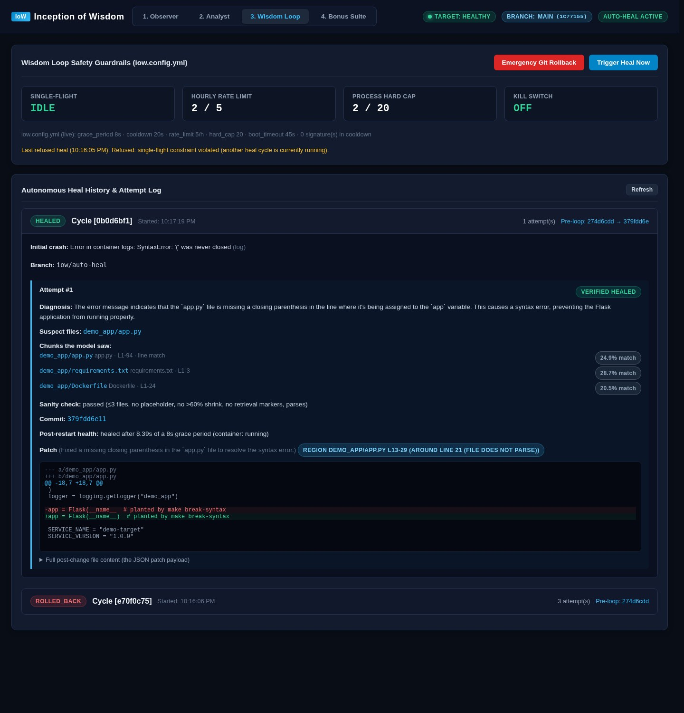
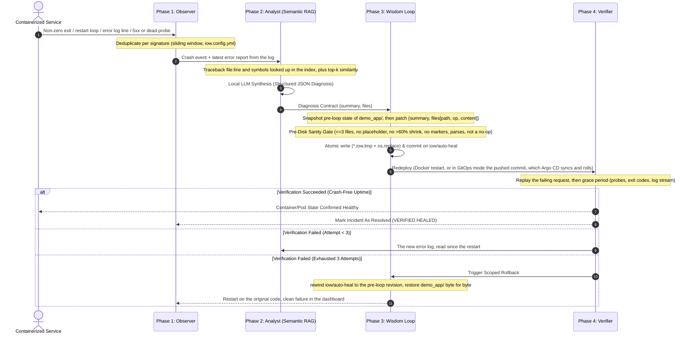
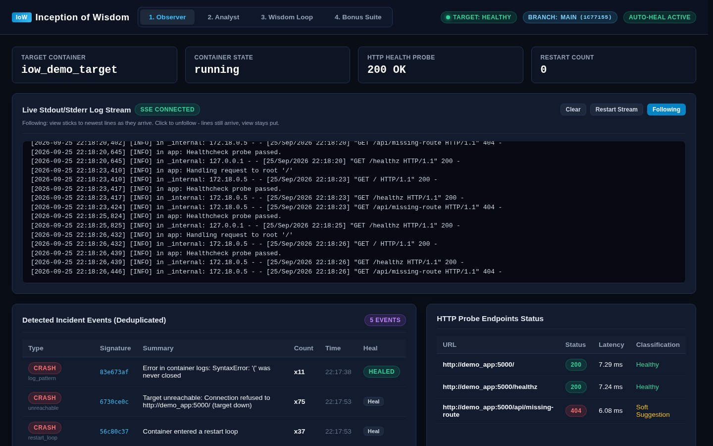
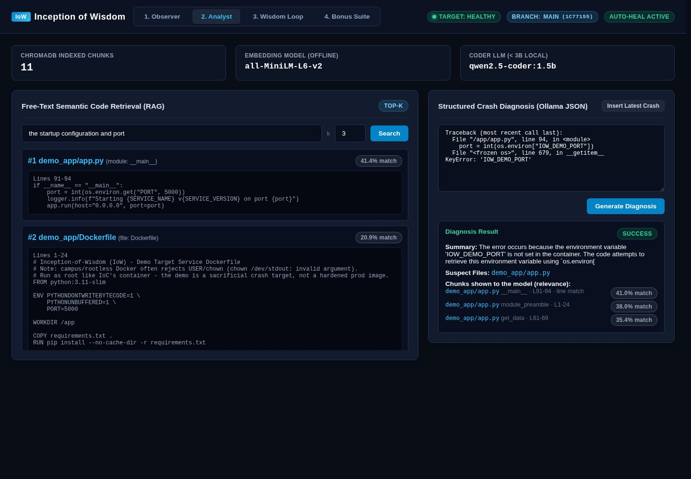
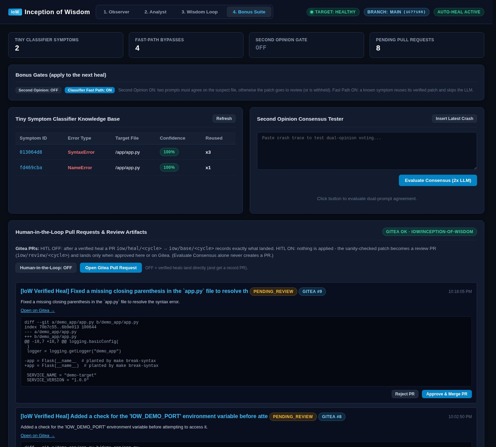
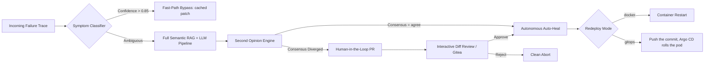

# Inception-of-Wisdom (IoW)

<div align="center">


# Enterprise Autonomous Self-Healing Platform for Containerized Infrastructure
**Crash Detection • Root-Cause Analysis by a Local LLM • Verified Remediation with Byte-for-Byte Rollback**

[](https://www.python.org/)
[](https://www.docker.com/)
[](https://www.trychroma.com/)
[](https://ollama.ai)
[](https://fastapi.tiangolo.com)
[]()
[]()

<br>

[System Architecture](#-system-architecture) •
[Autonomous Resilience Workflow](#-autonomous-resilience-workflow) •
[Unified Observability Center](#-unified-observability-center) •
[Enterprise Reliability Extensions](#-enterprise-reliability-extensions) •
[Production Guardrails](#-production-guardrails--configuration) •
[Operational Guide](#-operational-guide) •
[Interactive Documentation](#-interactive-documentation)

</div>

---

## Executive Overview

**Inception-of-Wisdom (IoW)** is an autonomous site-reliability and self-healing agent for containerized application stacks. By continuously intercepting infrastructure telemetry, real-time log streams, and HTTP synthetic health probes, IoW detects operational failures, identifies root causes through semantic code analysis, synthesizes corrective patches, and validates service recovery.

### Core Architectural Principles

* **Local at Run Time:** All machine learning inference (embeddings via `all-MiniLM-L6-v2` and code diagnosis via `Qwen 2.5 Coder 1.5B`) runs on local host hardware. No cloud LLM API is ever called, and nothing leaves the machine while the system runs; only the first `make setup` / `make up` downloads packages, images and models. The model samples (temperature 0.1, 0.4, 0.7 across attempts), so two runs on the same crash can propose different fixes - each one goes through the same sanity gate and verification.
* **Deterministic AST Code Intelligence:** Application source code is parsed into Abstract Syntax Trees, preserving discrete function and class boundaries rather than using arbitrary character chunking.
* **Non-Destructive Atomic Patching:** Corrective changes are structured as full-file replacements and validated through strict pre-disk sanity boundaries, preventing partial corruptions and syntax regressions.
* **Scoped Rollback Guarantee:** The loop never checks a branch out. Before the first attempt it records the exact state of `demo_app/` the target is running as the pre-loop revision (a snapshot commit when the working tree differs from the branch, e.g. an uncommitted planted bug). Heal commits stack onto `iow/auto-heal` with git plumbing (`hash-object` / `commit-tree` / `update-ref`), so HEAD, your index and every file outside `demo_app/` stay exactly where you left them. After 3 failed attempts the branch is rewound to the pre-loop revision, `demo_app/` is restored from it through a throwaway index, and the result is checked against the pre-loop tree hash (shown in the dashboard as *identical*). The cycle in progress is recorded in git (`refs/iow/pre-loop`), so an agent stopped or crashed mid-cycle rolls its unverified patch back the next time it starts. An edit someone makes to `demo_app/` while a cycle runs cannot survive the byte-for-byte rollback, but it is not lost: it is committed under `refs/iow/overwritten/<time>` first and named in the dashboard.

---

## Autonomous Resilience Workflow

<div align="center">



</div>

The remediation engine operates across four deterministic phases:



---

## Unified Observability Center

The centralized administrative interface provides a modern SRE console powered by **FastAPI** and **Server-Sent Events (SSE)**:

<div align="center">



| Analyst | Bonus Suite |
|:---:|:---:|
|  |  |

</div>

### Functional Modules

| Module | Component | Description |
|:---|:---|:---|
| **1. Observer** | `p1/observer_api.py` | Live container lifecycle telemetry (`running`, `restarting`, `dead`), real-time FIFO log streaming, active synthetic HTTP probes, and deduplicated incident log. |
| **2. Analyst** | `p2/analyst_api.py` | Semantic vector search across indexed codebase chunks, real-time cosine similarity ranking, and structured root-cause diagnostic reports. |
| **3. Wisdom Loop** | `p3/loop_api.py` | Multi-turn remediation history, full-file JSON patch inspector, commit SHA tracking, dynamic safety metrics, manual remediation trigger, and force rollback. |
| **4. Extensions** | `bonus/bonus_api.py` | Symptom classifier stats, Second Opinion consensus tester, Gitea HITL / verified PR queue, and GitOps redeploy hooks (`bonus/gitops.py`). |

---

## System Architecture & Subsystems

```
.
├── p1/                         # PHASE 1: TELEMETRY & OBSERVATION
│   ├── docker_monitor.py       # Container state + Docker event stream (non-zero exits, OOM)
│   ├── log_streamer.py         # Real-time stdout/stderr stream parser & regex triage
│   ├── http_probe.py           # Discriminates hard crashes from soft suggestions (4xx vs 5xx)
│   ├── event_manager.py        # Sliding-window incident deduplication (90s crash / 300s suggestion)
│   ├── observer_api.py         # Reactive SSE stream & telemetry REST endpoints
│   └── tests/                  # make test-p1
│
├── p2/                         # PHASE 2: SEMANTIC CODE ANALYSIS
│   ├── chunker.py              # AST logical chunks: functions, classes, module blocks, __main__
│   ├── db.py                   # Persistent ChromaDB client & local embedding pipeline
│   ├── retriever.py            # Top-k similarity + traceback file:line / symbol lookups in the index
│   ├── diagnostician.py        # Local LLM structured JSON diagnosis (cites indexed files only)
│   ├── watcher.py              # Watch mode: incremental re-index of changed files
│   ├── analyst_api.py          # Semantic code search & diagnostic query endpoints
│   └── tests/                  # make test-p2
│
├── p3/                         # PHASE 3 & 4: REMEDIATION & VERIFICATION
│   ├── patcher.py              # Model-written fixes packed into full-file JSON patches
│   ├── sanity.py               # Pre-disk gate: file count, placeholders, shrinkage, markers, scope, AST
│   ├── names.py                # Names a file uses but never defines (read with ast, no model)
│   ├── exits.py                # A "fix" that only moves the crash: new raise / exit, conditional start
│   ├── unbound.py              # A value read where it may not be set yet (NameError after the redeploy)
│   ├── git_manager.py          # Pre-loop snapshot, iow/auto-heal commits, byte-for-byte rollback
│   ├── verifier.py             # Redeploy, replay the failing request, grace period
│   ├── loop.py                 # Multi-turn coordinator (up to 3 attempts with failure feedback)
│   ├── safety.py               # Guardrails: single-flight, cooldown, rate limit, hard cap, kill switch
│   ├── loop_api.py             # Remediation orchestration & emergency rollback API
│   └── tests/                  # make test-p3
│
├── bonus/                      # ENTERPRISE RELIABILITY EXTENSIONS
│   ├── classifier.py           # Known-symptom classifier: reuses a verified patch, skips the LLM
│   ├── consensus.py            # "Second Opinion" dual-perspective consensus engine
│   ├── pr_manager.py           # Human-in-the-Loop PR review manager with live unified diff
│   ├── gitops.py               # GitOps redeploy: push the commit, wait for Argo CD's pod of that code
│   ├── bonus_api.py            # Fast-path triage, consensus scoring & PR approval endpoints
│   └── tests/                  # make test-bonus
│
├── k8s/                        # ARGO CD DESIRED STATE
│   └── demo-app/               # Namespace, Deployment and NodePort manifests
│
├── scripts/                    # CAMPUS-SAFE GITOPS BOOTSTRAP & OPERATIONS
│   ├── agent_entrypoint.sh     # Agent container: run as the owner of the mounted repo
│   ├── gitea_bootstrap.sh      # Gitea admin user, API token and review repository
│   ├── argocd_bonus_up.sh      # Creates iow-k3s and installs/configures Argo CD
│   ├── argocd_bonus_down.sh    # Removes the GitOps runtime
│   ├── gitops_publish.sh       # demo_app/ -> the branch Argo CD tracks (Argo CD rolls the pod)
│   ├── ensure_gitops_tools.sh  # Installs kubectl/argocd under /tmp/iow/bin
│   └── gitops_doctor.sh        # Diagnoses and optionally purges broken GitOps state
│
├── dashboard/                  # UNIFIED OPERATIONS DASHBOARD
│   ├── app.py                  # Central FastAPI application uniting all subsystems
│   ├── templates/index.html    # Modern SRE interface with 4 functional tabs
│   └── tests/                  # make test-dashboard (orchestrator, Makefile, compose, scripts, docs)
│
├── demo_app/                   # TARGET APPLICATION SUITE
│   ├── app.py                  # Containerized service featuring synthetic failure endpoints
│   ├── Dockerfile              # Target microservice container definition
│   ├── requirements.txt        # Runtime dependencies
│   └── iow.config.yml          # Production limits & operational timing parameters
│
├── presentation/               # TECHNICAL DOCUMENTATION SUITE (10 Offline Decks)
│   ├── PRESENTATION.html       # Complete Architecture Overview (EN)
│   ├── PRESENTATION_HU.html    # Teljes Rendszerarchitektúra (HU)
│   ├── P1_PRESENTATION.html    # Phase 1: Observer Deep-Dive (EN)
│   ├── P1_PRESENTATION_HU.html # Phase 1: Observer Részletes Bemutató (HU)
│   ├── P2_PRESENTATION.html    # Phase 2: Analyst & Semantic RAG (EN)
│   ├── P2_PRESENTATION_HU.html # Phase 2: Analyst & Szemantikus RAG (HU)
│   ├── P3_PRESENTATION.html    # Phase 3: Remediation & Rollback (EN)
│   ├── P3_PRESENTATION_HU.html # Phase 3: Javítás és Visszaállítás (HU)
│   ├── BONUS_PRESENTATION.html # Enterprise Extensions Deep-Dive (EN)
│   └── BONUS_PRESENTATION_HU.html # Vállalati Kiegészítések Bemutató (HU)
│
├── docker-compose.yml          # Orchestrated multi-container stack definition
├── Makefile                    # Operational commands and build workflows
└── .gitattributes              # Language metadata configuration (100% Python)
```

---

## Enterprise Reliability Extensions

To meet rigorous production reliability and compliance standards, the platform includes four governance extensions:



### 1. Known-Symptom Classifier (`bonus/classifier.py`)
* **Objective:** Eliminate LLM latency for deterministic, known failure modes.
* **Mechanism:** Extracts exception signatures / stack coordinates; stores verified heals under `/tmp/iow/classifier_store.json`.
* **Governance:** When confidence exceeds **0.85** and a cached patch exists, attempt 1 applies it and skips vector search + LLM (`fast_path_classifier` flag, Bonus tab toggle). A cached patch is complete files, so it is only replayed onto exactly the code it was learned on (each entry records the pre-heal hash of every file it replaces); on changed code the crash goes to the model instead of silently reverting unrelated edits. It still goes through the sanity gate and verification; a cached patch that fails loses confidence (−0.25) and is evicted below 0.40.
* **Test:** Bonus tab → classifier stats; heals after a verified fix train the store for the next identical crash.

### 2. "Second Opinion" Consensus Engine (`bonus/consensus.py`)
* **Objective:** Mitigate single-prompt hallucination in sub-3B parameter models.
* **Mechanism:** Two independent prompts (root-cause vs defensive architecture) vote on suspect files.
* **Governance:** Only an agreement triggers the patch - on every attempt: a retry after a failed verification is voted on again, and a divergence there is a failed attempt (after three, the usual rollback). On a divergence before the first attempt the patch goes to a review PR, or - with no forge reachable - is withheld and recorded in the history; it is never applied autonomously. Off by default (`second_opinion_mandatory`), toggled in the Bonus tab.
* **Test:** Bonus tab → **Second Opinion Consensus Tester**, or `POST /api/bonus/consensus/evaluate`.

### 3. Human-in-the-Loop PR Manager (`bonus/pr_manager.py`)
* **Objective:** Auditable change management via local **Gitea** (`make pr-bonus` / `make gitea`).
* **Mechanism:** With HITL on nothing is applied until approval: the patch (after the sanity gate) becomes a review branch `iow/review/...` with a dashboard diff. Approving lands exactly that commit, the way the loop lands a heal: under the heal bounds (kill switch, single-flight, rate limit, hard cap), redeployed through the Verifier (in GitOps mode that pushes the branch Argo CD tracks), and kept only if the target stays up for the grace period - otherwise it is rolled back to the PR's base and marked `reverted`. The PR is merged on Gitea as well: the approval waits while Gitea is still checking the PR, and a merge Gitea refuses is reported (the PR then stays open there). The decision also shows on the heal cycle that proposed the PR in the Wisdom Loop tab (healed, rolled back, or refused with the reviewer's reason). A PR whose base no longer matches the target's code is refused as stale instead of reverting the newer code, and a PR created through the API passes the sanity gate first. Verified heals also get a record PR (`iow/heal/<cycle>` → `iow/base/<cycle>`) when HITL is off. A decided PR's local branch is deleted (Gitea keeps its own copy), and at start the agent deletes the branches of PRs no longer on record - the records live under `/tmp/iow`, which a reboot wipes - touching only branches whose tip the agent wrote.
* **Credentials:** `/tmp/iow/gitea/gitea.env` - UI http://127.0.0.1:3000 (`iow` / `iowiow123`).
* **API:** `GET /api/bonus/prs`, `POST /api/bonus/prs/create`, `/prs/{id}/merge`, `/prs/{id}/reject`.

### 4. GitOps Redeploy (`bonus/gitops.py` + `make argocd-bonus`)
* **Objective:** In GitOps mode the heal commit alone redeploys the target through **Argo CD**. Every commit the agent writes stamps the git tree hash of its `demo_app/` into the Deployment's pod template (`iow.42/source` in `k8s/demo-app/deployment.yaml`), so a code change is a manifest change: Argo CD, which the bootstrap sets to reconcile every 15 s, syncs it and rolls the pod by itself. The agent pushes the branch and waits for a Ready pod of exactly that code, then the usual grace period. It asks Argo CD for a sync only when nothing moved within 75 s (`IOW_GITOPS_SELF_SYNC_S`), and restarts the rollout itself only when there is no new code to roll (the same code again, or a manifest without the stamp).
* **Campus path:** Nested k3d fails under rootless Docker (missing `cpu` cgroup). Bootstrap runs **`iow-k3s`** - privileged k3s-in-Docker with `--cgroupns=host` - then installs Argo CD and syncs from Gitea over `iow-network`. Each run rebuilds `inception-of-wisdom-demo_app:latest` from root `demo_app/`, imports it into k3s, and publishes both `demo_app/` and `k8s/demo-app` to Gitea so the cluster app matches compose (`:5001`). Pods reach Gitea through the Service `gitea.iow` the bootstrap creates (compose names such as `iow_gitea` do not resolve inside the cluster). The Observer follows the newest pod, so a new revision that crash-loops behind a still-serving old pod is seen.
* **Plant a crash in the cluster:** the pod runs what is on the branch Argo CD tracks, not your local files, so a `make break-*` alone changes nothing it serves. `make break-import gitops-publish` publishes the working tree's `demo_app/` to that branch with its stamp, and Argo CD rolls the pod within about 15 s; the loop heals from the same tree and pushes its fix there. `make demo-reset gitops-publish` puts the original code back.
* **URLs:** Argo UI http://127.0.0.1:8080 (`admin` / password printed by make; `IOW_ARGOCD_PORT=18080 make argocd-bonus` when 8080 is taken - the bootstrap never forwards onto a busy port, and the agent only logs in to a server that answers like Argo CD); in-cluster demo NodePort http://127.0.0.1:30051; dashboard http://127.0.0.1:8000.
* **Ops:** `make gitops-doctor` / `make gitops-doctor-purge` / `make argocd-bonus-down` / `make ensure-gitops-tools`.

---

## Production Guardrails & Configuration

Operational limits are loaded dynamically from [`demo_app/iow.config.yml`](demo_app/iow.config.yml) (subject requirement - do not hard-code timings in application logic). Defaults:

```yaml
# demo_app/iow.config.yml  (re-read on every change - no restart needed)
grace_period: 20          # Seconds the target must remain stable to confirm recovery
cooldown: 300             # Minimum seconds before the same incident signature may retrigger
rate_limit_per_hour: 5    # Maximum autonomous remediation flights per rolling hour
hard_cap: 20              # Absolute total lifecycle remediation operations before manual reset
boot_timeout: 45          # Seconds a redeployed target may take to answer
kill_switch: false        # Immediate global kill-switch: set to true to refuse all actions

target:
  probe_urls: ["/", "/healthz", "/api/missing-route"]   # the last one is a 4xx suggestion
```

For a smooth defense, set `grace_period: 5` - the running agent picks it up at once.
The `target:` and `analyst:` sections are live as well (probe URLs, error patterns,
dedup windows, probe/watch intervals, `top_k`, `patch_strategy`); only `container_name`,
`service_url`, `model` and `embedding_model` wait for a restart. A typo in `kill_switch` never
disarms it, any unusable value keeps the last good one, an empty file (an editor
mid-save) keeps the last good values, a deleted file keeps the current ones (one warning,
not one per reload), and a deleted key falls back to its default.

### Pre-Disk Sanity Filters (`p3/sanity.py`)
Before any AI-generated patch is applied to the filesystem, it must pass:
1. **File Count Bound:** Maximum 3 files modified per operation.
2. **Shrinkage Guard:** A file may not shrink by more than 60% - whatever the `op` says (a `create` over an existing file counts, deleting a non-empty file is a 100% shrink) and whatever its size.
3. **Trivial Placeholder Filter:** A non-empty file may not become a stub (`pass`, `...`, a docstring, `TODO`), and lazy markers (`# TODO`, `rest of code unchanged`) may not be introduced.
4. **Retrieval Marker Filter:** Prompt scaffolding (`--- File: … ---`, `--- Code Snippet #n ---`, region fences) may not leak into the code.
5. **Scope:** Only paths inside `demo_app/`, never the operator-owned `iow.config.yml`.
6. **AST Syntax Parse & no-op check:** Modified Python must compile, and a patch identical to the file on disk is refused.
7. **No lost definitions:** A patch may not leave a name undefined that the file still uses - a rewrite that drops an import or a constant is refused before it costs a redeploy.
8. **No value read before it is set:** A patch may not read a name where it may not be set yet - `port` set only inside an `if`, or inside a `try` whose `except` falls through - which would fail with a NameError after the redeploy (`p3/unbound.py`).

Heal writes and rollback are **scoped to `demo_app/`** (`p3/git_manager.py`), and the
loop never checks out a branch, so agent/dashboard WIP is never touched. There is no
canned answer for any particular bug. A sub-3B model cannot echo a 100-line file back
as a JSON string, so when the traceback points into a larger file the model rewrites
only that logical chunk (plain code) and the Patcher splices it into the complete
post-change file of the structured JSON patch; small files get a full-file rewrite.
`analyst.patch_strategy: full_file` in `iow.config.yml` has the model write that JSON
patch itself every time - the strictest reading of the subject; measured with
`qwen2.5-coder:1.5b` on `demo_app/app.py` it cut the file to a few lines in 9 of 9
answers (refused by the truncation guard), against 4 of 9 usable region rewrites.
An answer that cannot fix the crash is asked for again inside the same attempt (up to
three asks), before it costs a redeploy: a region handed back unchanged, a "fix" that
only moves the failure - a new `raise` / `exit()`, or the server started only when the
missing value is there (`p3/exits.py`, read with `ast`) - or one that reads a value it sets
on some paths only (`p3/unbound.py`). On `make break-env` that is what
4 of 6 first answers did; with the re-ask 8 of 9 attempts produced a working fix, and the
live heals went from 4 of 8 to 6 of 6 (all on attempt 1).
Every retry learns from the failure before it: it is told what failed after the redeploy
(and when the failure comes from code its own change added, such as a `raise` for a
missing value), it samples more freely (temperature 0.1, 0.4, 0.7), and for environment
problems the prompt states the target's port and environment as read from its container
(secrets never shown).
Stopping Ollama makes the Analyst report an explicit failure rather than inventing a
culprit.

---

## Operational Guide

### Ports (quick map)

| Port | Service |
|:---:|:---|
| **8000** | Dashboard: the agent container (`make up`) or a host run (`make p1`–`p3` / `bonus` / `run`); override with `PORT=` |
| **5001** | Docker demo target (`iow_demo_target` → container :5000) |
| **3000** | Local Gitea forge |
| **30051** | In-cluster demo NodePort after `argocd-bonus` |
| **8080** | Argo CD UI (port-forwarded by `argocd-bonus`; `IOW_ARGOCD_PORT=` moves it) |
| **6550** | k3s API (`iow-k3s`) |
| **11436** | Host Ollama for the host runs (`make setup`; avoids campus :11434 / IoC :11435). The compose `iow_ollama` publishes no host port - the agent reaches it as `http://ollama:11434` |

### Primary Workflow

**Everything in one command (subject entry point).** `make up` is backed by
`docker compose up`: the agent in its own container, the local LLM runtime and the
demo target (plus the Gitea forge for the PR bonus). The first run builds the agent
image (CPU-only torch) and pulls the model; about 5 minutes on campus.

```sh
make up                    # = docker compose up --build -d, waits for the dashboard
# dashboard → http://127.0.0.1:8000        (IOW_MODE=p1|p2|p3 make up for one stage)
make down                  # tear it down

# without make (rootless Docker on campus needs the socket path):
export DOCKER_SOCK="$XDG_RUNTIME_DIR/docker.sock"
docker compose up --build
```

The agent container runs as the owner of the checkout (`scripts/agent_entrypoint.sh`):
on rootful Docker it drops to your uid before writing patched files or git objects, on
rootless Docker your user already is uid 0 inside it.

**Host workflow (faster on campus: reuses one Ollama and one venv under `/tmp/iow`):**

```sh
make setup                 # once (or after fclean) - venv, deps, embeddings, ollama
make up-infra              # demo_app + gitea only; leaves :8000 free for the host dashboard
make p3                    # dashboard :8000 with the Wisdom Loop unlocked
# or: make bonus           # + classifier / consensus
# or: make pr-bonus        # + Gitea HITL / verified PRs
# or: make argocd-bonus    # + iow-k3s + Argo CD GitOps
```

**Crashes to heal or observe:**

```sh
make break-import          # startup crash: missing import → restart loop      (heal it)
make break-env             # startup crash: reads an unset environment variable (heal it)
make break-syntax          # startup crash: syntax error                      (heal it)
make break-hard            # the process exits 1 (Observer: exit-code event)
make break                 # HTTP 500 + traceback on POST /api/crash (Observer: log + 5xx)
make suggest               # 4xx probe → suggestion, flagged but never auto-healed
make heal                  # manual heal trigger (latest crash; 409 when nothing crashed)
make rollback              # put demo_app/ back to the last cycle's pre-loop revision
make demo-reset            # restore demo_app/app.py from HEAD + restart the target
make status | logs
```

A target stopped on purpose (`docker stop`, `docker kill`, `docker pause`) is not a crash:
the Observer reports the outage, the dashboard shows the target as *stopped* or *paused*
(the tooltip names the command that brings it back), and no heal starts - a manual one is
recorded as refused, with nothing to patch.

`make break` and `make break-hard` hit routes whose whole purpose is to crash. The
model either rewrites the route until the replayed request answers 2xx (seen live on
attempt 3, after the replay had failed a docstring edit and a commented-out `raise`),
or declines to change it, and the loop rolls back cleanly. To show a rollback,
stop the model (`make stop` for the host Ollama, `docker stop iow_ollama` in Docker) and
plant a crash. The three startup crashes are the runtime failures the subject recommends.

**Quality gates:**

```sh
make lint                  # flake8 + mypy
make test                  # p1 p2 p3 bonus dashboard tests (no model, no Docker)
make test-p3               # one part, verbose (test-p1 ... test-bonus, test-dashboard)
make gates                 # all of the above
```

`dashboard/tests` covers what joins the parts: which crash the orchestrator heals, how a
review's outcome reaches the heal history, the GitOps wiring, and the entry points around
it (Makefile, compose, Dockerfiles, the agent's entrypoint, scripts, manifests, the page),
plus that the docs only name files and config keys that exist.

### Which stage does what

Observation is always live; patching waits for the stage that owns Part 3.

| Command | Observer | Analyst | Wisdom Loop | Bonus |
|:--|:--:|:--:|:--:|:--:|
| `make p1` | yes | locked | locked | locked |
| `make p2` | yes | yes | locked | locked |
| `make p3` | yes | yes | **yes** | locked |
| `make bonus` / `pr-bonus` / `argocd-bonus` / `run` | yes | yes | yes | **yes** |

In `p1` and `p2` the loop endpoints answer `409` instead of patching, and before the
bonus stages so do the Bonus actions (flags, second opinion, PR create/approve/reject),
so a peer can step through the parts without the agent quietly committing behind the
locked tab.

### Bonus / GitOps targets

```sh
make bonus                 # classifier + consensus (Bonus tab)
make pr-bonus              # + Gitea forge + HITL / verified heal PRs
make argocd-bonus          # + k3s-in-Docker + Argo CD (CLIs → /tmp/iow/bin)
make break-import gitops-publish   # plant a crash in the cluster (demo_app/ -> tracked branch, Argo CD rolls the pod)
make argocd-bonus-down     # delete iow-k3s (+ legacy k3d leftovers)
make ensure-gitops-tools   # kubectl / argocd only
make gitops-doctor         # inspect compose vs iow-k3s
make gitops-doctor-purge   # wipe broken GitOps only (keep demo/gitea)
make gitea                 # forge only → http://127.0.0.1:3000
make up-agent              # alias of make up (everything in Docker)
make docker-restart        # recreate demo + gitea (not iow_agent)
make docker-clean          # stop IoW containers (keep images)
make docker-fclean         # remove IoW containers + images (compose/Gitea/k3s/alpine)
```

Credentials: `/tmp/iow/gitea/gitea.env` (user `iow`, pass `iowiow123`).  
GitOps env: `/tmp/iow/gitops/env` - demo `http://127.0.0.1:30051`.

Campus: nested **k3d** fails under rootless Docker (`failed to find cpu cgroup (v2)`).  
`make argocd-bonus` uses privileged **`iow-k3s`** + `--cgroupns=host`, attaches to `iow-network` for Gitea, rebuilds/imports the same `demo_app` image as compose, syncs `demo_app/` + manifests to Gitea, sets Argo CD to reconcile every 15 s, and port-forwards Argo to :8080.

```sh
source /tmp/iow/gitops/path.env
kubectl get nodes
kubectl -n iow-demo get pods,svc
# Argo CD: http://127.0.0.1:8080  (admin / password printed by make argocd-bonus)
```

### Runtime under `/tmp/iow`

```sh
make setup                 # venv + pip + embeddings + ollama on :11436
make run                   # all tabs unlocked on :8000
make clean                 # wipe chroma / caches under /tmp/iow (keep tools optional)
make fclean                # docker-fclean + full wipe of /tmp/iow
make re                    # fclean + setup
```

`ensure-ready` auto-runs `make setup` if the venv/deps are missing (e.g. after `fclean`).

---

## Technical Deep-Dives & FAQs

<details>
<summary><b>Why full-file replacement instead of unified diffs (git apply)?</b></summary>
<br>
Small LLMs (< 3B parameters) struggle with character-accurate arithmetic required for unified diff line offsets (<code>@@ -12,4 +12,6 @@</code>). Attempting to apply hallucinated diff headers results in rejection by standard patch utilities. Structured full-file replacement provides deterministic, reliable code application while remaining strictly governed by our file-count and shrinkage guards.
</details>

<details>
<summary><b>How are infinite restart and patch loops prevented?</b></summary>
<br>
Through a layered defense-in-depth approach:
1. Event deduplication sliding window (90 seconds for crashes - longer than Docker's 60 s maximum restart backoff, and at least 330 s in GitOps mode, where Kubernetes backs off up to 300 s - and 300 for suggestions): an ongoing crash loop stays one event. A verified heal - or the target serving again, however it came back - ends the outage, so the same crash planted again is a new event (still subject to the cooldown).
2. One heal at a time (single-flight); signals raised while it runs (exit code, log line, dead probe of the same crash) share its cooldown.
3. Per-signature cooldown periods (300 seconds).
4. Rolling hourly rate-limits (<strong>5</strong> heals/hour) and hard lifetime caps (<strong>20</strong>) from <code>iow.config.yml</code>, plus the <code>kill_switch</code>.
5. Turn-limited remediation flights (maximum 3 attempts), then a rollback of <code>demo_app/</code> to the pre-loop revision.
6. No heal without a symptom: before anything is patched the failing request is replayed (or the target's state and probes are read); a crash that is already gone is recorded as <code>not_needed</code> and nothing is changed, a target stopped or paused on purpose is reported but never patched, and a manual trigger with no crash and no log answers <code>409</code>.
</details>

<details>
<summary><b>How does incremental indexing work in ChromaDB?</b></summary>
<br>
ChromaDB runs as a <code>PersistentClient</code> under <code>/tmp/iow/chroma_db</code> (see <code>CHROMA_CACHE_DIR</code>), shared by the host runs and the agent container. The AST parser computes a SHA-256 hash per logical chunk (function, class, method, module block, <code>__main__</code>); a watcher polls the tree every 3 s and re-embeds only changed chunks, updates the line range of code that merely moved, and prunes what disappeared. A restart re-embeds nothing.
</details>

<details>
<summary><b>Why not nested k3d on campus?</b></summary>
<br>
Rootless Docker only delegates <code>memory</code>/<code>pids</code> cgroup controllers to the user. Nested k3d/k3s fatals with <code>failed to find cpu cgroup (v2)</code>. IoW uses a single privileged <code>iow-k3s</code> container with <code>--cgroupns=host</code> and kubelet flags for user namespaces, then installs Argo CD inside that cluster.
</details>

---

## Interactive Documentation

Ten self-contained, offline-compatible HTML5 technical presentations are available in the [`presentation/`](presentation/) directory. They require no internet connection, feature full keyboard navigation, and include architectural walkthroughs:

| Deck | Language | Focus |
|:---|:---:|:---|
| [`presentation/PRESENTATION.html`](presentation/PRESENTATION.html) | EN | Overall System Architecture & The 4-Phase Loop |
| [`presentation/PRESENTATION_HU.html`](presentation/PRESENTATION_HU.html) | HU | Teljes Rendszerarchitektúra és Működési Hurok |
| [`presentation/P1_PRESENTATION.html`](presentation/P1_PRESENTATION.html) | EN | Phase 1: Observation, Telemetry & Ingestion |
| [`presentation/P1_PRESENTATION_HU.html`](presentation/P1_PRESENTATION_HU.html) | HU | 1. Fázis: Megfigyelés, Telemetria és Eseménykezelés |
| [`presentation/P2_PRESENTATION.html`](presentation/P2_PRESENTATION.html) | EN | Phase 2: AST Analysis, Vector Storage & LLM Diagnosis |
| [`presentation/P2_PRESENTATION_HU.html`](presentation/P2_PRESENTATION_HU.html) | HU | 2. Fázis: AST Elemzés, Vektoros Keresés és Diagnosztika |
| [`presentation/P3_PRESENTATION.html`](presentation/P3_PRESENTATION.html) | EN | Phase 3: Patch Synthesis, Verification & Atomic Rollback |
| [`presentation/P3_PRESENTATION_HU.html`](presentation/P3_PRESENTATION_HU.html) | HU | 3. Fázis: Javítás, Verifikáció és Atomikus Rollback |
| [`presentation/BONUS_PRESENTATION.html`](presentation/BONUS_PRESENTATION.html) | EN | Enterprise Reliability Extensions & Governance |
| [`presentation/BONUS_PRESENTATION_HU.html`](presentation/BONUS_PRESENTATION_HU.html) | HU | Vállalati Megbízhatósági Bővítmények és Felügyelet |

---

<div align="center">

**Inception-of-Wisdom (IoW)**<br>
*Local-LLM Incident Response • Offline at Run Time • Verified Heals with Byte-for-Byte Rollback*

</div>
